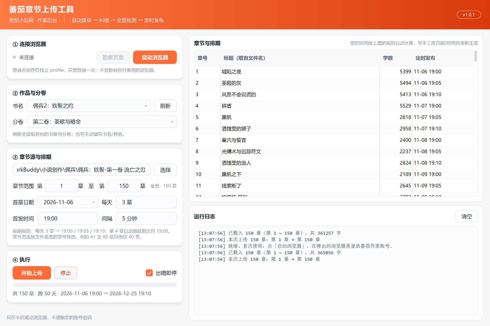

# 番茄章节上传工具（FanqieUploader）

把「每章一个 txt」的稿子批量传上**番茄小说网作家后台**，自动建章、自动纠错、自动全面检测、按规则定时发布。

Qt 6 Widgets 桌面程序，Windows 单文件 exe 可直接跑（`dist/` 已带运行库）。



---

## 它替你做的 7 步

对着后台手工点一遍是这样的，工具把这套动作全部自动化：

| 步骤 | 后台操作 | 工具行为 |
|---|---|---|
| 1 | 鼠标移到书上 → 点【章节管理】 | 悬停书卡 → 找「章节管理」→ 点进去（找不到就按书名定位） |
| 2 | 选卷 → 点【新建章节】 | 打开分卷下拉 → 选中你指定的卷 → 新建章 |
| 3 | 填章号、标题、正文 → 点【下一步】 | 按文件名还原章号/标题，正文写进编辑器后校验字数 |
| 4 | 弹「还有错别字未修改」→ 点【取消】→ 纠错页点【替换全部】→【下一步】 | 自动取消提交 → 替换全部 → 下一步，**循环到出现全面检测为止** |
| 5 | 全面检测窗口点【全面检测】 | 点全面检测；一旦有风险，**存草稿 + 弹警告 + 中断** |
| 6 | 发布设置：AI 选【否】→ 打开【定时发布】 | 点「否」、打开开关、填日期与时间，并**回读校验** |
| 7 | 设日期 + 19:00 → 【确认发布】 | 按排期表填日期时间 → 确认发布 → 抓回执 → 下一章 |

## 排期规则

按你给的规则算，不用手算：

- 每天 **3** 章，都在 **19:00 / 19:05 / 19:10**
- 第 4 章自动顺延到**次日** 19:00，第 5 章 19:05……
- 150 章 → 跨 50 天，首章 11-06 19:00，末章 12-25 19:10

「每天章数」「首发时间」「间隔」都在界面上可改；填的日期就是**首章日期**。

## 章节范围（只传一段）

目录里 150 章、这次只想补传 41~80？在「③ 章节源与排期」里把范围改成 `第 41 章 至 第 80 章` 即可：

- 默认按目录里的**最小章号 ~ 最大章号**全选，右侧表格与排期表立刻按范围重算
- 范围只筛章号，不改文件名与正文；改完起止值会自动重排定时时间
- 起止写反了也能用（自动取小值到大值）；范围为空会提示，不会误发

## 快速开始

1. 解压 `FanqieUploader-v1.0.5-win64-portable.zip`，双击 `FanqieUploader.exe`
2. 点 **「启动浏览器」** —— 会用独立 profile 起一个 Edge/Chrome 并打开作家后台
3. 在这个浏览器里**登录一次**（登录态会一直留着，不影响你日常用的浏览器）
4. 在浏览器里进到**目标书的「章节管理」页**，点工具里的 **「刷新」** 读书名与分卷
5. 选章节文件夹（用 [txt文档章节编辑器](https://github.com/carson631) 拆好的那一堆 `1城陷之夜.txt`），按需限定章节范围
6. 设「首章日期」，核对左下角排期与右侧表格
7. 点 **「开始上传」**，弹窗确认后开始跑；跑的时候别去动那个浏览器页面

## 章节文件格式

文件名决定章号与标题，正文取文件内容（UTF-8 或 GBK 都认）：

```
1城陷之夜.txt      → 第 1 章，标题「城陷之夜」
026 圣殿的灰.txt   → 第 26 章，标题「圣殿的灰」
第3章 风是不会说谎的.txt → 第 3 章
```

正文原样写入（保留行首全角缩进），换行归一为 LF 后再交给编辑器。

## 异常处理（重要）

| 情况 | 工具行为 |
|---|---|
| 全面检测出风险 | **先点【存草稿】保住内容** → 弹警告 → 中断整批上传，等你人工处理 |
| 点「确认发布」后没抓到回执 | 存草稿 + 警告 + 中断（结果不确定，请到后台核对，避免重复发） |
| 定时日期/时间没设进去 | **不点确认发布**（否则会立刻发出去）→ 存草稿 + 中断 |
| 正文写入字数对不上 | 存草稿 + 中断 |
| 其它步骤失败 | 默认「出错即停」；正文已填过的会先存草稿 |

「出错即停」可以取消勾选，让它在普通失败后继续下一章——但**风险和发布失败永远会中断**。

## 技术实现

- **不内嵌浏览器**：MinGW 版 Qt 根本没有 WebEngine 模块（`aqt list-qt` 里查不到），所以走 Chrome DevTools Protocol，用 `--remote-debugging-port` 驱动你本机的 Edge/Chrome。好处是登录态天然复用。
- **不依赖 class 名**：番茄的类是构建后随机化的，所有定位都按「可见文本 + placeholder + 结构位置」来，配合「取面积最小的候选」避免点到外层容器。
  - 例外是书名/分卷这两处有稳定语义类名的（`.home-book-item` / `.completion-book-item` / `.info-content-title`），优先用它们，取不到再退回文本启发式。
  - 书名识别另有一份「后台固定文案黑名单」（章节管理 / 新建章节 / 创建章节 / 作品相关 / 已发布 / 连载中 …），并排除 `第N章` 形式的章节行，避免把按钮和章节预览当成书名。
  - 卷名收紧为「`第X卷[: 卷名]` 且卷名内不含空格」，容器拼接出来的长文本一律不算；下拉里按卷号升序排列。
- **每步都自检**：找不到元素时会把当前页面的按钮清单、输入框清单打进日志，方便第一时间定位是哪一步失配。
- **失败不留半成品**：正文写进去之后出任何岔子，都先把草稿存下来再中断。

## 常用排障

**「没找到番茄页面」**
浏览器没打开作家后台，或还在登录页。点「启动浏览器」，登录后停在 `fanqienovel.com/main/writer/` 下任意页。

**「没读到书名」**
当前在章节管理页。点页面左上角的「番茄小说网」回到作品管理页，再点「刷新」。

**「点不到新建章节 / 下一步」**
点 **「勘察页面」**，日志会打印当前页所有可见按钮。把那段日志发出来即可定位。

**想验证脚本逻辑（不登录也能跑）**

```bash
msedge --headless=new --virtual-time-budget=9000 --dump-dom tools/test.html
```

`tools/test.html` 用真实浏览器跑 50 项断言，覆盖错别字弹窗、纠错页、检测弹窗、风险识别、发布设置、存草稿、选卷、书名识别（连载/已完结两种书卡）、容器文本不被当成卷名、填章号/标题/正文等判定逻辑。

**想对着真实后台复验书名/分卷**

```bash
# 先用工具自己那个 profile 起一个带调试端口的浏览器
msedge --headless=new --remote-debugging-port=9333 \
       --user-data-dir="%LOCALAPPDATA%\carson\FanqieUploader\browser-profile" \
       https://fanqienovel.com/main/writer/book-manage
# 再注入 site.js 并读一次
python tools/cdp_probe.py 9333 js/site.js "__fq.books()" "__fq.volumes()"
```

## 目录

```
FanqieUploader/
├─ mainwindow.cpp/h      界面与章节装载、排期
├─ uploadworker.cpp/h    逐章状态机（含熔断与存草稿兜底）
├─ cdpclient.cpp/h       DevTools 协议客户端
├─ browserlauncher.cpp/h 拉起带调试端口的 Edge/Chrome
├─ js/site.js            页面自动化脚本（文本驱动，25 个接口）
├─ tools/test.html       headless 逻辑自测（50 项）
├─ tools/cdp_probe.py    对真实后台做一次勘察（注入 site.js + 读书名/分卷）
├─ tools/cdp_tabtest/    多标签接管逻辑的 C++ 冒烟测试
├─ tools/followtest/     真机版接管测试（点新建章节→接住新标签→判定编辑页）
└─ dist/                 便携版（自带 Qt 运行库）
```

## 免责

仅供把自己写的稿子批量整理上传，请遵守番茄小说网的创作者协议。工具不会绕过任何审核，风险提示一律中断交给人处理。
